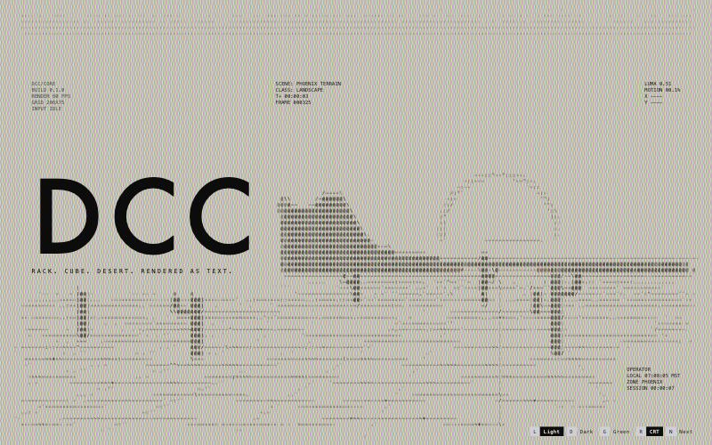
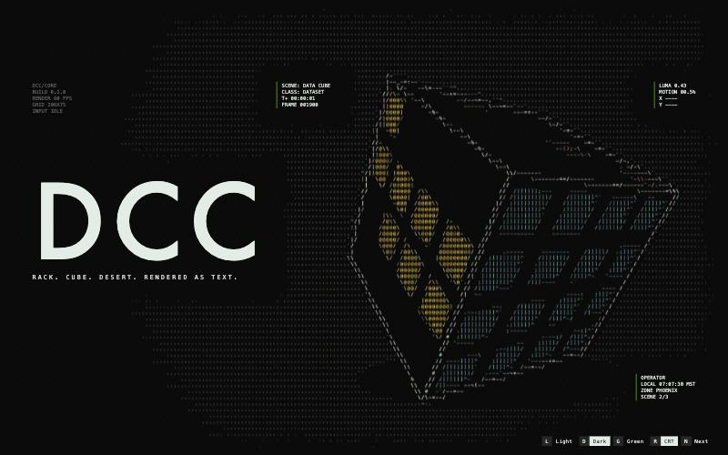
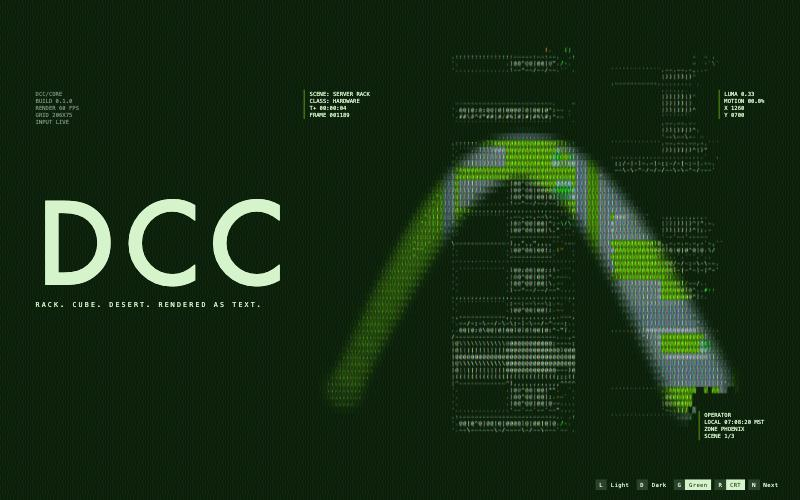

# DCC

A full-screen field of text characters that resolves into imagery. Three scenes rotate underneath it: a server rack, a rotating data cube, and Phoenix desert terrain. The cursor lights and recolours the field as it moves, and a click blasts it apart.





## Run it

```sh
npm install
npm run dev      # http://localhost:5173
npm run build    # type-checks, then builds to dist/
```

Needs WebGL2 (any current Chrome, Edge, Firefox or Safari).

| Key | Does |
|---|---|
| L / D / G | Light, dark or green theme |
| R | CRT scanlines, bloom and shadow mask |
| N | Next scene (they also rotate every 14 s) |

Click anywhere on the field to blast it.

## How it works

Each frame goes through four steps.

1. **Scene.** A scene draws itself with Canvas2D into a small canvas sized to exactly 2 x 3 samples per character cell. Canvas antialiasing does the area averaging.
2. **Contrast.** A 96 x 54 copy of the frame is histogrammed on the CPU. A contrast-limited equalization curve (tall bins clipped at 3x an even share, excess spread evenly) is eased frame to frame and uploaded as a 256 x 1 texture, so every scene uses the full glyph range and scene changes do not pump. The same pass produces the LUMA and MOTION readouts.
3. **Cells** (`src/gl/cells.frag.ts`, one fragment per cell). The six samples are equalized and mapped to ink: light paper prints the darkest half like a print, dark paper lights the brightest share like an engraving. Then:
   - strong, directional edges become a stroke along the contour (`| / - \`), chosen from the gradient angle;
   - everything else is matched against each glyph's measured 2 x 3 coverage, so flat areas get density characters and partial cells get partial shapes. Coverage is measured from the real font at startup (`src/gl/atlas.ts`);
   - the cursor trail, click blast, scene-change decode and edge dissolve are applied here too.
4. **Compose and CRT.** Each cell's glyph is drawn from the atlas over its tile colour. If CRT is on, the result goes through the CRT pass.

### Interaction

- **Trail.** The pointer leaves stamps every 7 px (and every 80 ms while resting). Each stamp lives 1 s and shrinks to 35% of its radius as it ages; overlapping stamps merge as a soft union. Where the trail passes, cells gain density, their background tile lifts, and glyphs take the scene's own hue pushed toward full saturation (the accent over grey).
- **Blast.** A ragged front expands from the click with a cubic ease-out. Cells inside are pushed outward, flash random characters or drop out, and sparks fly along random rays. It settles in 0.9 s.
- **Edge dissolve.** Every cell has its own dropout threshold (half white noise, half clumped value noise). Screen edges and the rectangles under the HUD text fade a mask across a feather, and each cell drops out when the mask falls below its threshold, so the field frays raggedly instead of cutting off square. Scene changes reuse the same thresholds: each cell switches scene at its own moment and flickers as it crosses.

## Adding a source

The ASCII pipeline only sees a `FrameSource` (`src/scenes/source.ts`): something that returns a canvas at the grid's sample resolution. Drawn scenes are wrapped by `DrawnSource`. To use video or a webcam, write a `FrameSource` that draws the `<video>` into a canvas of `sampleW x sampleH` and returns it, then add it to the `sources` list in `src/main.ts`. Nothing in `src/gl/` changes.

For a scene to read in every theme, keep its backdrop near the median brightness and put both darks and brights in the subject: light paper inks the darks, dark paper lights the brights.

## Credits

The CRT pass (`src/gl/crt.frag.ts`) is a WebGL2 port of Timothy Lottes' public-domain CRT scanline shader, from [libretro/glsl-shaders](https://github.com/libretro/glsl-shaders/blob/master/crt/shaders/crt-lottes.glsl). The filter, scanline, bloom and shadow-mask maths are unchanged. Changes are listed at the top of the file.
